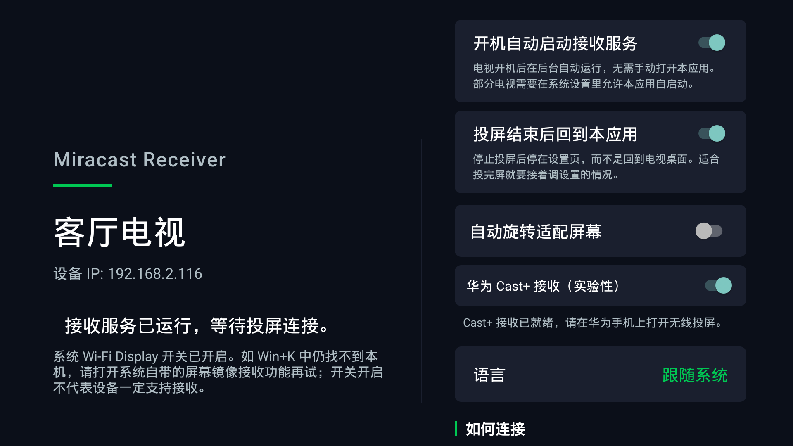
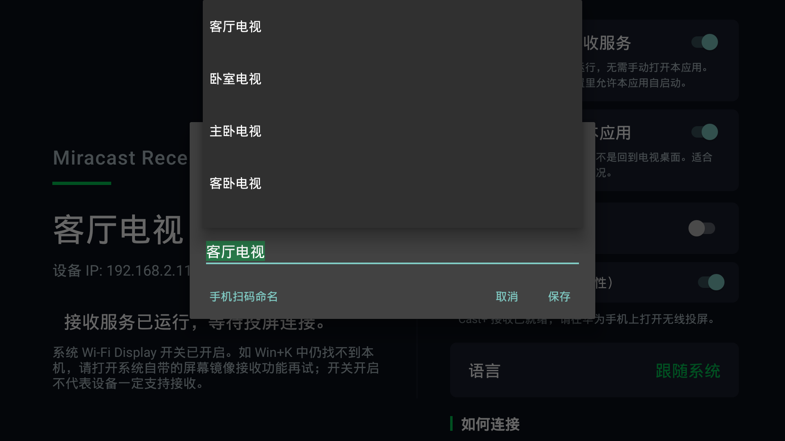
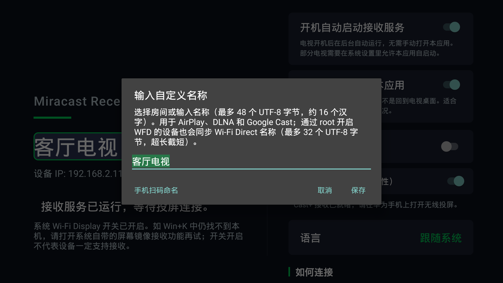

# MiracastReceiver

[](https://github.com/NNdroid/MiracastReceiver/actions/workflows/android-ci.yml)
[](https://developer.android.com/)
[](LICENSE)

MiracastReceiver is an Android TV casting receiver designed for always-on use. It supports AirPlay, DLNA/UPnP, Miracast/Wi-Fi Display, WebRTC, direct HTTP media playback, a remote WebUI, background auto-start, Android TV remote navigation, and hardware-accelerated playback where supported by the device.

The project is optimized for TV usage: it can keep the receiver service running after the UI is closed, exposes a 10-foot Android TV interface, provides a browser-based control center, and can use Root or Shizuku for additional background and Miracast-related integration on devices that need it.

## Highlights

- **AirPlay**
  - iPhone, iPad, and macOS discovery
  - Screen mirroring
  - Video casting
  - Audio playback
  - Low-latency H.264 hardware decode path where available

- **DLNA / UPnP**
  - Works with common DLNA-capable mobile and desktop applications
  - Suitable for media apps such as Emby and other UPnP/DLNA senders
  - Media3-based playback

- **Miracast / Wi-Fi Display**
  - Windows `Win + K` wireless display support
  - Android wireless display / Miracast support on compatible devices
  - RTSP session handling
  - RTP / MPEG-TS receive path
  - H.264 hardware decode through MediaCodec
  - AAC / LPCM audio handling
  - Designed for low-latency second-screen use
  - WFD sink advertisement adapted for Android 6.0 through Android 17 (see
    [WFD injection across Android versions](#wfd-injection-across-android-versions))

- **WebRTC**
  - Built-in HTTP/WebSocket signaling server (phase 1)
    - Default preferred port: `18095`
    - Serves a ready-to-use browser test sender at `http://<TV_IP>:18095/`
    - JSON signaling: SDP Offer/Answer exchange, ICE candidate exchange (trickle),
      `welcome`/`state`/`error` events, heartbeat `ping`/`pong`, and `bye` teardown
  - PeerConnection receive and playback (phase 2)
    - PeerConnection creation and configuration with hardware video codecs
    - Video track reception rendered through `SurfaceViewRenderer` in the player
    - Audio track reception played back through libwebrtc's `AudioTrack` output
    - LAN-direct connectivity (host candidates; no STUN server required)
  - Works with any WebRTC client that speaks the signaling protocol; the bundled
    browser page can share the screen, a window, a browser tab, or the camera/microphone

- **Direct HTTP media playback**
  - Push a media URL from the WebUI directly to the TV
  - HLS / `.m3u8`
  - MPEG-DASH / `.mpd`
  - MP4, TS, WebM, MP3, AAC, and other formats recognized by Android Media3
  - Optional `User-Agent`, `Referer`, and `Authorization` headers
  - Automatic retry for temporary network failures
  - Network recovery handling

- **Android TV interface**
  - TV-oriented 10-foot layout
  - D-pad focus navigation
  - Wrap-around focus chain for the main controls
  - Focus scaling and automatic scroll-into-view
  - Light and dark themes following the system configuration
  - Double-Back exit protection: the first Back press shows a Toast, and a second press within two seconds closes only the UI while the receiver service keeps running
  - Dedicated Android TV launcher banner and adaptive application icon

- **WebUI control center**
  - Default preferred port: `18090`
  - Automatic temporary fallback to an available port when the preferred port is already in use
  - QR-code access from the TV screen
  - Dashboard, protocol configuration, player controls, diagnostics, and logs
  - Direct HTTP / HLS / DASH URL playback
  - Responsive light and dark themes
  - English, Simplified Chinese, Traditional Chinese, Japanese, and Korean UI

- **Configurable WebUI authentication**
  - **Generated token**: persistent random token generated by the application
  - **Custom token**: user-defined token, 8–128 characters, with whitespace/control characters rejected
  - **No authentication**: direct LAN access without a token
  - QR-code behavior automatically follows the selected authentication mode
  - Token information is passed through the URL fragment (`#token=...`) so it is not sent in the HTTP request URL

- **Always-on receiver service**
  - Foreground receiver service
  - Auto-start after boot
  - Service stays active when the main Activity is closed
  - Magisk `service.d` fallback when available
  - Root and Shizuku-assisted background optimization

- **Internationalization**
  - English
  - Simplified Chinese
  - Traditional Chinese
  - Japanese
  - Korean
  - Android 13+ per-app language support
  - CI checks that localized Android string resources remain complete

## Supported Sources

| Source | Protocol | Status | Notes |
|---|---|---|---|
| iPhone / iPad | AirPlay | Supported | Screen mirroring, media, and audio |
| macOS | AirPlay | Supported | Native AirPlay sender support |
| Android apps | DLNA / UPnP | Supported | Works with compatible media apps |
| Android system casting | Miracast | Device dependent | Some TVs require elevated privileges for WFD advertisement |
| Windows | Miracast | Supported on compatible TVs | Use `Win + K` |
| Windows / Linux media apps | DLNA / HTTP | Supported | Depends on sender capabilities |
| Emby / similar media servers | DLNA | Supported | Client behavior may vary |
| Browser / WebUI | HTTP / HLS / DASH | Supported | Push a direct URL to the TV player |
| Browser (Chrome / Edge) | WebRTC | Supported | Open `http://<TV_IP>:18095/` and share screen or camera |
| Custom apps | WebRTC | Supported | Any client speaking the WebSocket signaling protocol |

## Requirements

- Android 5.0+ (`minSdk 21`)
- Android TV or Google TV is the primary target
- LAN connectivity for discovery and WebUI access
- JDK 17 for development builds
- Android SDK API 37 for compilation (supports devices up to Android 17)

Some Miracast features depend on the TV firmware. Devices that already expose a system Wi-Fi Display implementation generally work more easily. Other devices may require Root to expose or modify WFD-related behavior.

## Installation

Build artifacts are produced by GitHub Actions for pull requests and supported CI runs. The workflow builds a debug APK and uploads it as an artifact.

For a local installation with ADB:

```bash
adb install -r app-debug.apk
```

For a remote Android TV with network ADB enabled:

```bash
adb connect <TV_IP>:5555
adb install -r app-debug.apk
```

## Quick Start

1. Install the APK on the Android TV device.
2. Open **MiracastReceiver** once to review the TV status screen and grant any required permissions.
3. Leave the receiver service enabled.
4. Use the protocol appropriate for the sender:
   - AirPlay from Apple devices
   - DLNA/UPnP from compatible media applications
   - Miracast / `Win + K` from Windows
   - The WebUI for remote control and direct HTTP/HLS/DASH playback
5. Scan the QR code shown on the TV to open the WebUI without manually typing a long address or token.

Closing the main TV interface does not stop the background receiver service.

## WebUI

The preferred WebUI port is:

```text
18090
```

If that port is occupied, MiracastReceiver selects a temporary available port without overwriting the configured preferred port. On the next service start, the preferred port is tried again.

The TV home screen displays the current runtime WebUI address and a QR code. When token authentication is active, the QR code carries the active token in the URL fragment rather than in the HTTP request path.

### Authentication modes

The WebUI supports three modes:

| Mode | Behavior |
|---|---|
| Generated token | Uses a persistent random token created by the application |
| Custom token | Uses a user-defined token validated by the application |
| No authentication | Anyone on the reachable LAN can access the WebUI |

Generated tokens remain stable across application, service, and TV restarts until explicitly rotated or application data is cleared.

## Direct URL Playback

The WebUI can launch remote media directly on the TV. Typical examples include:

```text
https://example.com/live/channel.m3u8
https://example.com/manifest.mpd
https://example.com/video.mp4
```

The player accepts only `http://` and `https://` URLs from this feature. Dangerous URI schemes such as `file://`, `content://`, `intent:`, `javascript:`, and `data:` are rejected.

Temporary network failures use bounded retry logic, and playback can resume when network connectivity returns.

## WebRTC Casting

WebRTC casting runs in two phases, both enabled by default (`webrtcEnabled` in the WebUI protocols page):

### Phase 1 — HTTP/WebSocket signaling server

- Preferred port `18095` (configurable as `webrtcPort`; the server walks upward past occupied ports like the WebUI does).
- `GET /` serves the bundled browser test sender; `GET /health` returns a JSON status snapshot.
- Any WebSocket upgrade starts a signaling session. One sender session is active at a time; a new session replaces the previous one.
- JSON message set:
  - Client → receiver: `{"type":"offer","sdp":...}`, `{"type":"candidate","sdpMid":..,"sdpMLineIndex":..,"candidate":..}`, `{"type":"ping"}`, `{"type":"bye"}`
  - Receiver → client: `{"type":"welcome","name":..,"port":..}`, `{"type":"answer","sdp":...}`, `{"type":"candidate",...}`, `{"type":"state","state":...}`, `{"type":"pong"}`, `{"type":"error","message":..}`

### Phase 2 — receive and playback

- PeerConnection is configured for LAN-direct use (host candidates, continual gathering, no STUN needed).
- Incoming video tracks render into a `SurfaceViewRenderer` inside the TV player (launched automatically when casting starts); incoming audio tracks play through libwebrtc's `AudioTrack` output module.
- Hardware video decoding/encoding paths are enabled through libwebrtc's factories with a shared `EglBase` context.

### Browser test sender

1. Open `http://<TV_IP>:18095/` in a desktop browser.
2. Choose **Screen/Window** (`getDisplayMedia`, with optional system audio) or **Camera + Microphone**.
3. Click **连接并开始投屏**; the TV launches the WebRTC player automatically.

Browsers only expose `getDisplayMedia`/`getUserMedia` in secure contexts. The page shows in-place guidance when opened over plain HTTP; easiest options are saving the page and opening it via `file://`, or adding the TV address to Chrome's `chrome://flags/#unsafely-treat-insecure-origin-as-secure` list. Custom WebRTC clients are unaffected by this browser restriction.

## WFD injection across Android versions

Android's Wi-Fi Display (WFD) capability can only be broadcast by `wpa_supplicant`. The framework
entry points (`WifiP2pManager.setWfdInfo` / `setWFDInfo`) require the signature-level
`CONFIGURE_WIFI_DISPLAY` permission on every release, so ordinary applications are always rejected
there. MiracastReceiver therefore injects the WFD sink IE directly into the supplicant control
socket via root, and adapts to each Android release:

| Android | Framework API surface | Receiver behavior |
|---|---|---|
| 6.0–11 (API 23–30) | hidden `setWFDInfo(Channel, WifiP2pWfdInfo, ActionListener)` only | reflected by name, rejected without the signature permission, falls back to root injection |
| 12–17 (API 31–37) | hidden `setWFDInfo` blocked by hidden-API enforcement (`maxTargetSdk = R`); `setWfdInfo` @SystemApi added | both reflection names are tried in turn; both fail for non-privileged apps, root injection remains authoritative |

The root injection path is hardened for the same range:

- Supplicant control sockets are discovered dynamically: well-known `p2p-dev-*`/`wlan*`/`p2p0`
  candidates under `/data/vendor/wifi/wpa/sockets` and `/data/misc/wifi/sockets` are checked first,
  then both directories are scanned for sockets with vendor-specific interface names (common on
  Android 15–17 builds).
- The WFD subelement is only written to a `p2p-dev-*` socket. That interface is what emits the P2P
  advertisement; the STA socket (`wlan0`) cannot broadcast it and the group socket (`p2p0`) does not
  exist until a group is formed, so per-socket attempts are scored by interface kind and the best
  acknowledged result wins.
- After `SET wifi_display 1` + `WFD_SUBELEM_SET 0 ...`, the state is read back
  (`GET wifi_display`, `WFD_SUBELEM_GET 0`). A socket whose read-back disagrees is skipped, and a
  blocked supplicant reply is reported as *unverified* instead of silently successful — the native
  helper distinguishes "acknowledged" (0), "rejected" (1) and "sent, never answered" (2), because an
  SELinux-blocked reply is indistinguishable from a missing command.
- A periodic keep-alive (45 s) re-advertises the sink because supplicant restarts and vendor scans
  clear the injected WFD subelements.

Injection alone is not enough for discovery: a Miracast source only lists P2P devices that advertise
Group Owner capability together with the WFD information element, so the receiver has to become the
Group Owner itself. The sink pipeline therefore runs in this order — initialize the P2pManager (which
brings `p2p-dev-*` up), inject the WFD IE into `p2p-dev-*`, raise the Group Owner intent to 15, form
the group as Group Owner, then re-inject the IE so it lands in the G/O beacon. Missing the group is
why a correctly injected sink can still be invisible in the source's device list. On Android 13+ the
`NEARBY_WIFI_DEVICES` permission is required for that discovery and group creation path.

If injection fails everywhere, the WebUI diagnostics panel (`GET /api/diagnostics`, `miracast` field)
and logcat (`WfdRootHelper`) show the reason, including whether the advertisement was verified by
read-back and whether the Group Owner intent took effect; the usual causes are a supplicant built
without `CONFIG_WIFI_DISPLAY` or an SELinux policy blocking the control socket.

## Android TV Remote Control Behavior

The main screen is designed for D-pad navigation:

- deterministic focus order
- wrap-around navigation from the last main control back to the first
- subtle focus scaling
- focused controls are automatically scrolled into view

The main screen also protects against accidental exit:

1. Press **Back** once to show an exit hint.
2. Press **Back** again within two seconds to close the Activity.
3. The background receiver service continues running.

The media player keeps its existing TV-oriented navigation behavior, including accelerated repeated seek operations inspired by Kodi-style controls.

## Root and Shizuku

Root is not mandatory for AirPlay, DLNA, the WebUI, or ordinary Media3 playback.

Root or Shizuku can be used for background-related optimizations, and Root may be required on some TV firmware for advanced Miracast / Wi-Fi Display integration where the system does not provide the necessary privileged WFD capabilities.

When Magisk is available, MiracastReceiver can install a `service.d` boot fallback so the receiver can be started more reliably after boot.

## Building from Source

Clone the repository:

```bash
git clone https://github.com/NNdroid/MiracastReceiver.git
cd MiracastReceiver/MiracastReceiver
```

Build a debug APK:

```bash
./gradlew assembleDebug
```

Run unit tests:

```bash
./gradlew testDebugUnitTest
```

Build a release APK:

```bash
./gradlew assembleRelease
```

Build a specific ABI when required:

```bash
./gradlew assembleRelease -PbuildArm64=true
./gradlew assembleRelease -PbuildArm32=true
```

APK outputs are written under:

```text
app/build/outputs/apk/
```

## Technology Stack

- Kotlin
- AndroidX / AppCompat
- Android TV / Leanback components
- Media3 / ExoPlayer
- MediaCodec
- libwebrtc (`io.getstream:stream-webrtc-android`, `org.webrtc` API surface)
- OkHttp
- Kotlin Coroutines
- ZXing
- Shizuku API
- mDNS / NSD
- RTSP / RTP / Wi-Fi Direct / WFD

## Continuous Integration

The Android CI workflow validates the project with checks including:

- WebUI JavaScript syntax validation
- Android TV branding resource validation
- localization completeness tests
- unit tests
- debug APK assembly
- debug APK artifact upload

## Known Limitations

### Miracast availability depends on TV firmware

Windows and Android system-level Miracast discovery requires Wi-Fi Display / WFD functionality at the platform level. Some TVs already expose the required capability; other devices may need Root-assisted integration.

### Wi-Fi Direct device naming

The Miracast name visible to Windows or Android may come from the system Wi-Fi Direct device name instead of the name configured inside MiracastReceiver. Recent Android versions restrict changing this value without privileged system permissions.

### Background Activity launch restrictions

Modern Android versions restrict applications from opening Activities from the background. MiracastReceiver uses TV-appropriate permission and service strategies, but firmware behavior differs between vendors. On some devices, overlay permission may be required so an incoming cast can bring the player to the foreground reliably.

### Sender interoperability

DLNA, AirPlay, and Miracast implementations vary across vendors. Some applications may use non-standard request formats or codec combinations that require additional compatibility work.

## Security Notes

- The WebUI is intended for trusted local networks.
- The WebRTC signaling server (`18095`) performs no authentication, mirroring how AirPlay/Miracast receivers behave; keep it disabled in untrusted networks via the WebUI protocols page.
- Keep token authentication enabled unless unauthenticated LAN control is explicitly desired.
- A custom WebUI token should be unique and not reused as an account password.
- Direct media playback restricts remote URLs to HTTP and HTTPS.
- The WebUI applies request-size and concurrent-client limits to reduce accidental or abusive resource consumption.

## Contributing

Issues and pull requests are welcome. When changing Android UI strings, update every supported locale because CI enforces locale key parity.

For protocol or playback changes, include tests where practical and verify that Android TV remote-control behavior is not regressed.

## License

This project is licensed under the MIT License. See [LICENSE](LICENSE).

## Acknowledgements

AirPlay mirroring work was informed by the protocol behavior and implementation ideas found in projects such as [PhairPlay](https://github.com/philippe44/PhairPlay).

---

## Upstream notes (weekdayjast/MiracastReceiver)

[English](#english) | [中文](#中文)

---

## 中文

### UxPlay 回归版本

ARM32 / ARM64 UxPlay 整理版保留已验证的 YouTube 播放、换片、字幕和镜像修复，清理临时协议日志并补齐现有语言资源。广告自动衔接与手机画质同步仍待验证。[详情](MiracastReceiver/AIRPLAY-UXPLAY.md)

v1.2.15 的 UxPlay 安装包要求 Android 6 及以上，应用 ID 为 `top.jast.miracastreceiver`。可覆盖安装 v1.2.14 并保留设置；更早使用不同包名的应用需先退出，避免端口冲突。

v1.2.15 修复小米相册 DLNA 连接、AirPlay 竖屏视频旋转后画面过小，以及 UxPlay 未应用旋转后分辨率声明的问题。改变接收端旋转方向后，需在 iPhone 停止投屏并重新连接，才会协商新的实际码流分辨率。

### ✨ 功能特性

- **🍎 AirPlay 支持**：完美支持 iPhone、iPad、Mac 投屏
  - 屏幕镜像（FairPlay 解密 + H.264 硬解码）
  - 视频投屏
  - 音频流播放

- **📺 DLNA/UPnP 支持**：兼容各平台 DLNA 客户端
  - Bilibili、优酷、爱奇艺等视频 App
  - Windows Media Player
  - VLC Player
  - Emby、Plex 等媒体服务器

- **Google Cast 媒体接收（实验性）**：复用 ExoPlayer 播放 HTTP/HTTPS 音视频，支持播放、暂停、跳转、音量和状态回传。仅实现 Default Media Receiver；不支持 Google 设备证书验证、YouTube 专用协议或屏幕镜像。详见 [能力范围与测试方法](MiracastReceiver/GOOGLE-CAST.md)。

- **华为 Cast+ 支持（实验性）**：在设置中开启后，可接收兼容华为手机的无线投屏，支持连接确认、PIN 码和画面旋转。已在 Sony Android 12 电视验证发现与投屏；其他机型仍需测试。详见 [启用方法与兼容范围](MiracastReceiver/HUAWEI-CASTPLUS.md)。

- **🖥️ Miracast/WFD**：Windows 无线显示器与安卓手机系统「投屏」共用的协议（**部分电视需要 root**，见[已知问题](#-已知问题)）
  - 完整 RTSP 会话协商（M1–M7）
  - MPEG-2 TS 解复用 + H.264 硬解码，直送 MediaCodec 低延迟渲染
  - AAC / LPCM 音频解码，收到即播，与画面同步输出
  - Wi-Fi Direct P2P + WFD IE 注入（Windows `Win+K`、安卓系统投屏均可直接发现）
  - 端到端延迟约 60–130 ms，可作为 Windows 的无线第二屏幕
  - 详见 [Windows 无线投屏 Root 配置说明](Windows无线投屏Root配置说明.md)

- **🎬 强大的播放能力**
  - 支持 HTTP/HTTPS 视频流
  - 支持 HLS（.m3u8）直播流
  - 支持多种视频格式（MP4、MKV、AVI 等）
  - 支持图片幻灯片播放
  - 倍速播放（0.5x - 2x）
  - 画质选择（480p - 1080p）

- **⚡ 开机自动启动**：电视开机后在后台自动拉起接收服务，无需手动打开应用
  - 等局域网 IP 就绪后再启动 AirPlay/DLNA/Miracast，避免开机瞬间广播绑错地址
  - 可在主界面的「开机自动启动接收服务」开关中关闭

### 📱 支持的投屏来源

| 平台 | 协议 | 状态 | 说明 |
|------|------|------|------|
| iPhone/iPad | AirPlay | ✅ 完美支持 | 屏幕镜像、视频、音频投屏 |
| Android 手机 | DLNA | ✅ 完美支持 | Bilibili、优酷等 App |
| Android 手机 | Miracast | ✅ 支持（部分需 root） | 系统自带「投屏」直接发现，整屏镜像含声音 |
| Windows | DLNA | ✅ 完美支持 | 媒体播放器投屏 |
| Windows | Miracast | ✅ 支持（部分需 root） | `Win+K` 直接发现，可当无线第二屏幕，含声音 |
| Mac | AirPlay | ✅ 完美支持 | 系统原生支持 |
| Emby/Plex | DLNA | ✅ 兼容 | 媒体服务器投屏 |

### 🚀 快速开始

#### 下载安装

1. 前往 [Releases](https://github.com/weekdayjast/MiracastReceiver/releases) 下载最新版本 APK
   - **ARM64 (推荐)**：适用于大多数现代 Android TV
   - **ARM32**：适用于老旧设备

2. 通过以下方式安装到 Android TV：
   - U 盘安装：复制 APK 到 U 盘，插入电视，用文件管理器打开安装
   - ADB 安装：`adb install app-release.apk`
   - 远程 ADB：`adb connect <TV_IP>:5555 && adb install app-release.apk`

#### 使用方法

1. 在 Android TV 上启动 **Miracast Receiver** 应用
2. 应用会显示设备名称、IP 地址和连接码
3. 根据你的设备选择投屏方式：

**iPhone/iPad 投屏**：
- 打开控制中心 → 屏幕镜像 → 选择 "Sony BRAVIA 4K VH22"（或你的设备名）
- 或在视频 App 中点击 AirPlay 图标

**Android 手机投屏**：
- 在支持 DLNA 的 App（如 Bilibili）中点击投屏按钮
- 选择显示的设备名称
- 或使用系统自带的「投屏 / 无线显示」整屏镜像（Miracast，部分电视需 root，见[已知问题](#-已知问题)）

**Windows 投屏**：
- 使用 VLC 或 Windows Media Player 的"播放到"功能
- 或使用 Emby、Plex 等媒体服务器
- 或按 `Win+K` 连接无线显示器（Miracast，部分电视需 root）

### 电视命名（Issue #33）

在应用主界面点击当前显示的设备名称，直接输入新名称；输入框支持下拉选择客厅、卧室、主卧、客卧、餐厅、书房等名称，也可输入自定义名称或恢复系统名称。选择「手机扫码命名」后，用同一局域网的手机扫码并在浏览器中保存；无需安装手机 App。二维码十分钟内有效，关闭窗口或离开应用后立即失效。

名称保存在本机，重启后保留；保存后刷新 AirPlay、DLNA 和 Google Cast 服务发现，重新打开手机投屏清单查看。中文名称最长约 16 字（48 个 UTF-8 字节）。通过 root 开启 WFD 的设备会同步 Wi-Fi Direct / Windows Win+K 名称，启动服务时也会重新应用。Wi-Fi Direct 最多 32 个 UTF-8 字节，超长名称会按完整字符截短；其他设备仍受系统权限限制。

以下截图来自 Sony 电视（192.168.2.116），示例名称为「客厅电视」。

1. 在主界面选中当前显示的电视名称，按遥控器确认键或直接点击。

   

2. 弹出名称输入框和备选清单，选择客厅、卧室、主卧等名称；需要自定义时收起清单，在输入框中编辑。

   

3. 确认输入框中的名称后点击「保存」，再重新打开手机投屏列表查看。也可点击「手机扫码命名」，通过同一局域网手机的浏览器修改并保存。

   

> 非 root 通过系统 Wi-Fi Direct 开启的 Miracast，列表名称仍可能是系统名称，应用内改名不保证同步；详见下方已知问题。

### 🛠️ 从源码构建

#### 环境要求

- Android Studio 2026.1+
- Android SDK API 36
- JDK 17+
- Gradle 8.11.1

#### 构建步骤

```bash
# 克隆仓库
git clone https://github.com/weekdayjast/MiracastReceiver.git
cd MiracastReceiver

# 构建 Debug APK
cd MiracastReceiver
./gradlew assembleDebug

# 构建 Release APK（需要配置签名）
./gradlew assembleRelease

# 生成 64 位和 32 位 APK
./gradlew assembleRelease -PbuildArm64=true
./gradlew assembleRelease -PbuildArm32=true
```

生成的 APK 位于：`app/build/outputs/apk/`

### 📖 文档

- [华为 Cast+ 实验性接收](MiracastReceiver/HUAWEI-CASTPLUS.md) - 启用方式、实现范围和验证清单
- [ADB 故障日志采集教程](ADB故障日志采集教程.md) - 故障复现、电视 / 盒子日志采集与 Issue 反馈要求
- [开发与调试指南](开发与调试指南.md) - 完整的开发、打包、安装和调试说明
- [Windows 无线投屏 Root 配置说明](Windows无线投屏Root配置说明.md) - Miracast 启用步骤、协议实现要点与排错
- [Windows 无线显示器](Windows无线显示器支持说明.md) - Miracast 协议背景说明

### 🔧 技术栈

- **语言**：Kotlin
- **最低 SDK**：Android 5.0 (API 21)
- **目标 SDK**：Android 14 (API 36)
- **UI 框架**：Android TV Leanback
- **视频播放**：ExoPlayer (Media3)
- **网络**：OkHttp, mDNS/NSD
- **协议**：AirPlay, DLNA/UPnP, Miracast/WFD, RTSP, RTP

### 🙏 致谢与参考

- 感谢 [UxPlay](https://github.com/FDH2/UxPlay) 提供 AirPlay 协议实现，以及 [android-airplay-server](https://github.com/jqssun/android-airplay-server) 提供 Android 接入与渲染参考；相关代码保留各自的许可证与来源声明。

- AirPlay 屏幕镜像实现借鉴并参考了 [PhairPlay](https://github.com/mazer666/PhairPlay) 项目的协议流程与实现思路。
- Google Cast 媒体接收参考了 [openchromecast](https://github.com/yukarikaname/openchromecast) 的协议定义与实现流程，保留其 MIT 许可声明。

### 🐛 已知问题

1. **Miracast（Windows 无线显示器 / 安卓系统投屏）在部分电视上需要 root**
   - 电视要被 Windows `Win+K` 和安卓系统投屏发现，必须对外广播 WFD IE
   - **系统自带「屏幕镜像」功能的电视（如 Sony BRAVIA）无需 root**：系统已经在广播 WFD IE，
     本应用直接接管会话。可用 `adb shell settings get global wifi_display_on` 确认，返回 `1` 即属于此类
   - 系统不带该功能的电视：广播 WFD IE 需要 signature 级权限 `CONFIGURE_WIFI_DISPLAY`，
     普通应用拿不到，只能在 root 后由应用自动注入；未 root 则无法使用，请改用 DLNA 投屏
   - 连接时电视上弹出「是否允许连接」的确认框是系统的 Wi-Fi Direct 授权流程，确认即可
   - 详见 [Windows 无线投屏 Root 配置说明](Windows无线投屏Root配置说明.md)

2. **Emby 投屏兼容性**
   - 部分 Emby 客户端的 SOAP 请求格式可能需要特殊处理

3. **非 root 开启 Wi-Fi Direct 投屏时，Miracast 名称可能显示不正确**
   - 非 root 设备使用系统 Wi-Fi Direct / 屏幕镜像功能开启投屏时，安卓手机和 Windows `Win+K` 列表可能仍显示 `Android_xxxx` 或系统型号，与应用内设置的电视名称不一致
   - 列表中的名称是系统管理的 Wi-Fi Direct 设备名；应用内直接改名或扫码保存名称，无法保证同步修改非 root 设备的该名称
   - Android 11 起修改该名称需要 `NETWORK_SETTINGS` 等系统级权限，普通应用无法修改，
     只能保持系统默认的 `Android_xxxx`
   - 如果电视的「设置 → 网络」里有 Wi-Fi Direct 设置页，可以在那里改名；没有该设置页时，通过 root 开启 WFD 的设备会由本应用同步名称
   - AirPlay / DLNA / Google Cast 使用应用内「电视名称」；未设置时使用电视系统设备名称

4. **需要「显示在其他应用上层」权限**
   - Android 10 起系统禁止后台弹出界面。未打开本应用时（开机自启后、或退回桌面后）投屏，
     播放页会被系统拦截，表现为投屏没有反应
   - 首次打开应用时会弹窗引导到系统设置页开启；如果电视没有该设置页，可用 adb 开启：
     `adb shell appops set top.jast.miracastreceiver SYSTEM_ALERT_WINDOW allow`

5. **Android Miracast 屏幕旋转后的分辨率声明尚未解决**
   - 已支持接收端旋转、角度保存和黑边内容适配，但部分 Android 发送端仍选择横屏 1920×1080 视频帧，将竖屏内容缩小后加黑边发送
   - 当前自定义分辨率扩展仅对支持该扩展的发送端生效；旋转、重连后仍不能保证按接收设备实际分辨率交换宽高
   - 放大显示无法恢复源端已经损失的细节，旋转后的清晰度仍可能偏低。详见 [Miracast 旋转说明](MiracastReceiver/MIRACAST-ROTATION.md)

### 🗺️ 后续计划

- **完善 AirPlay 支持**
  - 优化屏幕镜像稳定性和延迟
  - 优化音视频同步

- **完善 Miracast 投屏（Windows / 安卓）**（音视频已可用，见 [Root 配置说明](Windows无线投屏Root配置说明.md)）
  - 进一步压低延迟（当前约 60–130 ms）
  - 支持 `wfd_idr_request_capability`，丢包后主动请求关键帧以加快恢复
  - 探索按需建组，避免常驻占用 Wi-Fi Direct 接口

### 🤝 贡献

欢迎提交 Issue 和 Pull Request！

### 📄 许可证

本项目采用 MIT 许可证 - 详见 [LICENSE](LICENSE) 文件

---

## English

### ✨ Features

- **🍎 AirPlay Support**: Perfect compatibility with iPhone, iPad, and Mac
  - Screen mirroring (FairPlay decryption + H.264 hardware decoding)

- **Experimental Google Cast media receiver**: HTTP/HTTPS audio/video through ExoPlayer with playback controls and status feedback. Implements the Default Media Receiver; Google device-certificate validation, YouTube-specific protocols and screen mirroring are unsupported. See [scope and testing](MiracastReceiver/GOOGLE-CAST.md).

- **Huawei Cast+ support (experimental)**: Enable it in settings to receive wireless mirroring from compatible Huawei phones, with connection approval, PIN codes and rotation. Discovery and mirroring have been verified on a Sony Android 12 TV; other devices need testing. See [setup and scope](MiracastReceiver/HUAWEI-CASTPLUS.md).

- **🖥️ Miracast/WFD**: The protocol behind both Windows Wireless Display and Android's built-in screen casting (**root required on some TVs**, see [Known Issues](#-known-issues))
  - Full RTSP session negotiation (M1–M7)
  - MPEG-2 TS demuxing + H.264 hardware decoding, fed straight to MediaCodec
  - AAC / LPCM audio decoding, played as it arrives alongside the video
  - Wi-Fi Direct P2P with WFD IE injection (discoverable via `Win+K` and Android screen casting)
  - ~60–130 ms end-to-end latency, usable as a wireless second display
  - See [Root Setup Guide](Windows无线投屏Root配置说明.md) (Chinese)

### TV names (Issue #33)

Click the displayed device name on the main screen to edit it directly. The input offers room presets and the system name in its dropdown, and a button opens a QR code for a phone on the same LAN. Open the scanned link in a browser and save; no phone app is required. The QR link expires after ten minutes or when the dialog closes or the app leaves the foreground.

Names persist across restarts and refresh AirPlay, DLNA and Google Cast discovery without restarting playback. Reopen the sender’s device list after saving. Custom names allow up to 48 UTF-8 bytes. Devices enabling WFD through root also synchronize the Wi-Fi Direct / Windows Win+K name, including at service startup. Wi-Fi Direct names are shortened at complete character boundaries to 32 UTF-8 bytes; other devices remain subject to system permissions.

Screenshots from the Sony TV at 192.168.2.116 (Chinese UI): select the current name on the [home screen](docs/images/tv-name-home.png), choose a [room preset](docs/images/tv-name-presets.png) or type a custom name, then [save](docs/images/tv-name-edit.png). The same dialog offers QR naming from a phone browser on the same LAN. Non-root system Wi-Fi Direct names may remain unchanged; see Known Issues below.

### 🛠️ Build from Source

- Thanks to [UxPlay](https://github.com/FDH2/UxPlay) for its AirPlay protocol implementation and [android-airplay-server](https://github.com/jqssun/android-airplay-server) for the Android integration and rendering reference. Their license and source notices are retained.

- AirPlay screen mirroring is inspired by and references the protocol flow and implementation ideas from [PhairPlay](https://github.com/mazer666/PhairPlay).
- Google Cast media reception references [openchromecast](https://github.com/yukarikaname/openchromecast), with its MIT copyright and license retained.

3. **Incorrect Miracast name with non-root Wi-Fi Direct casting**
   - On non-root devices using system Wi-Fi Direct / screen mirroring, Android casting and Windows `Win+K` may show `Android_xxxx` or the system model instead of the TV name configured in the app
   - This Wi-Fi Direct name is system-managed; renaming in the app or via the QR page cannot guarantee it will be synchronized on non-root devices
   - Since Android 11, renaming it requires system permissions such as `NETWORK_SETTINGS`, so the app
     cannot change it and the system default `Android_xxxx` remains
   - If the TV has a Wi-Fi Direct page under Settings → Network, rename it there; otherwise devices enabling WFD through root synchronize the name through this app
   - AirPlay / DLNA / Google Cast use the app’s TV name, falling back to the TV system device name

4. **"Display over other apps" permission required**
   - Since Android 10, apps may not open screens from the background. When the app is not open
     (after auto-start on boot, or after returning to the home screen), the player is blocked and casting appears to do nothing
   - The app prompts for it on first launch and opens the system settings page; if the TV has no such page, grant it via adb:
     `adb shell appops set top.jast.miracastreceiver SYSTEM_ALERT_WINDOW allow`

5. **Unresolved: resolution declaration after rotating Android Miracast**
   - Receiver rotation, saved angles and black-bar fitting are supported, but some Android senders still transmit portrait content inside a landscape 1920×1080 frame
   - Custom resolution extensions work only with compatible senders; rotating and reconnecting do not guarantee a stream matching the receiver’s actual dimensions with width and height exchanged
   - Enlarging the content cannot recover detail already lost at the sender, so rotated mirroring can remain blurry. See [rotation details](MiracastReceiver/MIRACAST-ROTATION.md)

If you find this project helpful, please give it a star!

## 🙏 贡献者感谢 / Contributors

感谢以下贡献者为项目贡献代码、功能改进和设备验证，也感谢所有提交问题、提供日志和参与测试的朋友。

Thanks to the following contributors for their code, improvements, and device testing, and to everyone who reports issues, shares logs, and helps test the app.

| 贡献者 / Contributor |
| --- |
| [@arjuntam](https://github.com/arjuntam) |
| [@Googler0825](https://github.com/Googler0825) |
| [@aby1987](https://github.com/aby1987) |
| [@dcstf](https://github.com/dcstf) |

[查看完整贡献者名单 / View all contributors](https://github.com/weekdayjast/MiracastReceiver/graphs/contributors)
